# K — Architectural Streetwear E-Commerce, 3D Virtual Fitting Lab & Hybrid `pgvector` Graph RAG

> Production full-stack streetwear commerce engine featuring an editorial **EN / FR / AR (RTL)** storefront with **Day / Night Mode**, a live **Three.js 3D Virtual Fitting Lab**, a privacy-hardened **Personal Stylist Concierge**, and an **Independent Admin Studio** (`/admin`) powered by **Supabase (`pgvector` 0.8.2 HNSW + Row-Level Security)**, a **2-Hop Knowledge Graph**, and **Groq LPU** inference.

---

## Live Architecture Overview

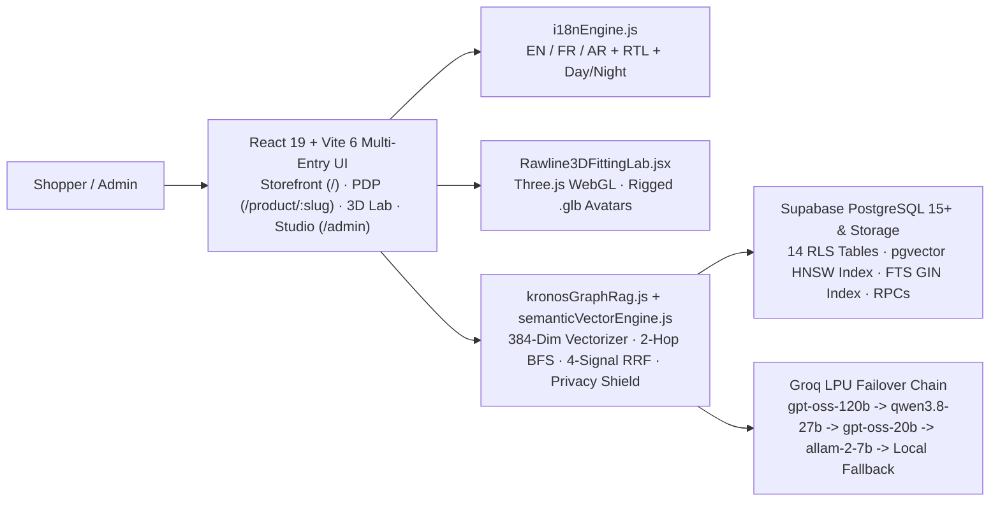

Deep dives:
- [**System Architecture & Hybrid Retrieval Blueprint**](docs/ARCHITECTURE.md)
- [**Supabase PostgreSQL & `pgvector` Schema Reference**](docs/SUPABASE_SCHEMA.md)

---

## Visual Tour — Every Page & Studio Module

### 1. Storefront Hero & Editorial Navigation (`/`)
Floating island navigation bar with folded `K` identity mark, category dropdowns, `Drops`, `Sale`, `New`, `PERSONAL STYLIST` launcher, `3D LAB` bridge, **Day / Night Mode** toggle, **EN / FR / AR** language switcher, and live **TND (`DT`)** currency selector.

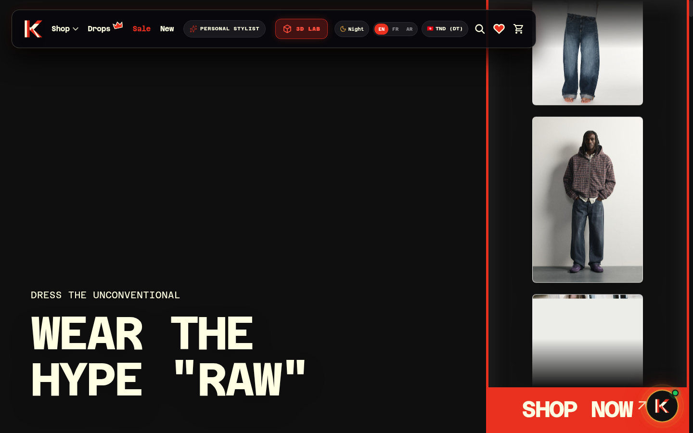

### 2. Studio Collection Catalog & Gender Filters (`56` Live Pieces — `28` MEN · `28` WOMEN)
Full multi-category editorial grid synchronized directly with Supabase `products`, featuring `ALL (56)` / `MAN (28)` / `WOMAN (28)` filters, category chips (`Jeans`, `Jackets`, `Overshirts`, `Blazers`, `Coats`, `Hoodies`, `Dresses`, `Knitwear`, `Trousers`, `Tops`, `T-Shirts`, `Shirts`, `Polos`, `Shoes`, `Bags`), colorway swatches, and instant wishlist/bag actions.

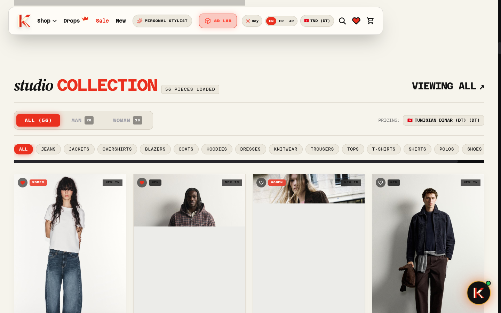

### 3. Intelligent Multilingual & Arabic (`AR`) RTL Support
Intelligent contextual localization across **English**, **French**, and **Arabic** (`dir="rtl"` mirrored hero typography, RTL navigation layout, localized badges, and culturally natural stylist replies).

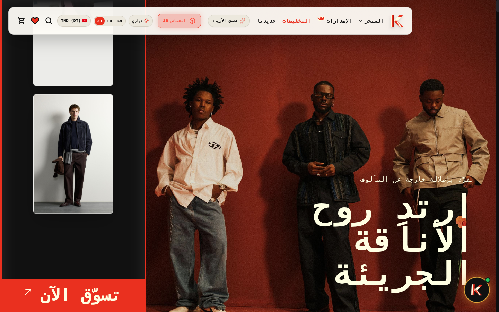

### 4. `K · PERSONAL STYLIST` — Storefront Client Concierge
Client-facing AI advisor backed by **Supabase `pgvector` HNSW + 2-Hop Knowledge Graph** retrieval:
- Enforces the **Storefront Client Privacy Shield** (blocks financial revenue, total `commandes`, internal stock counts, and subscriber lists).
- Enforces **Strict `MEN` / `WOMEN` Gender Isolation** across vector hits, outfit tables, and recommendation cards.
- Injects direct **`3D`** try-on launch buttons and **`+ BAG`** commerce controls inside every matched card.

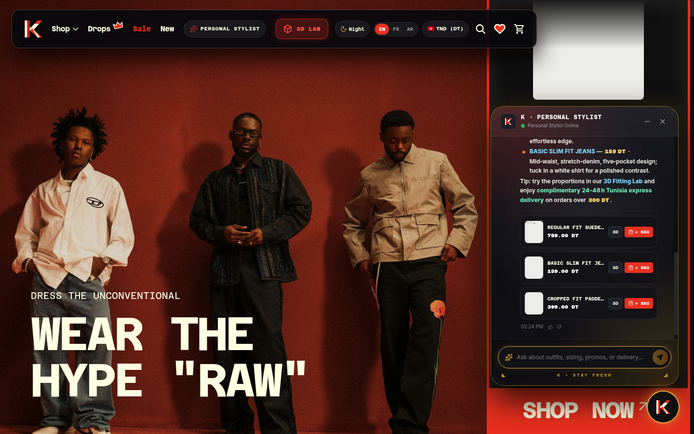

### 5. Three.js 3D Virtual Try-On Lab (`#3d-fitting-lab`)
Interactive WebGL garment fitting studio loading rigged `man.glb` (184 cm), `woman.glb` (175 cm), and `animations.glb`, offering multi-angle camera presets (`FRONT`, `3/4`, `SIDE`, `BACK`), skin tone shaders, lighting environments (`Zara Studio`, `Architectural Dark`, `Golden Editorial`), and instant catalog outfit swaps.

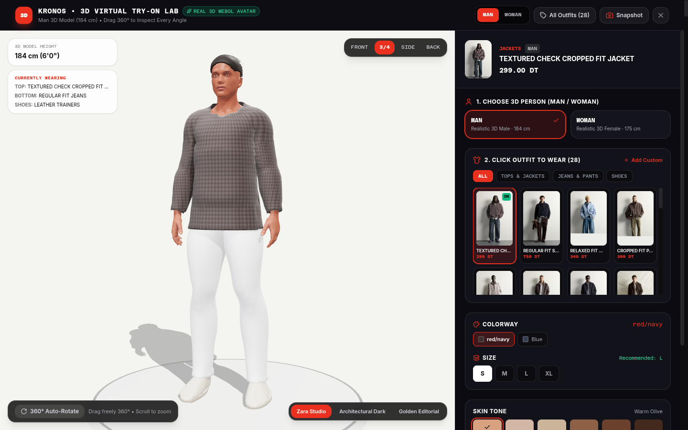

### 6. Dedicated Product Detail Page (`/product/:slug`)
Clean editorial PDP with multi-colorway switching, sizing selection, garment descriptions, cross-selling pairings, and 1-click launch into the 3D Virtual Fitting Lab.

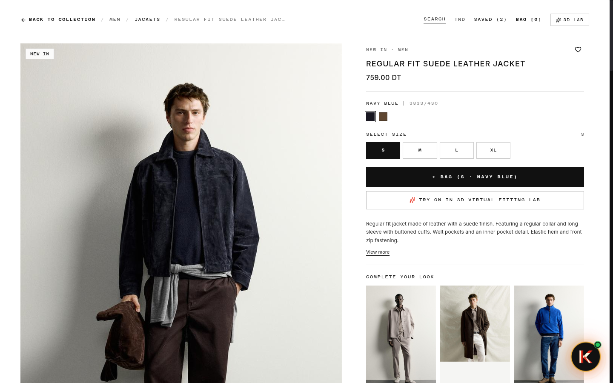

---

## Independent Admin Studio (`/admin` & `/admin-kronos-2026`)

Protected by Supabase Authentication + Row-Level Security (`RLS`).

### 7. AI Assistant & Graph RAG Studio + Live 7-Point Verification
Admin-only Copilot injected with the complete `ADMIN FULL PROJECT DOSSIER` (live GMV in `DT`, `commandes` breakdown, low-stock alerts, active promo codes, media vault counts, and Q&A telemetry logs), paired side-by-side with the **Multi-Hop Graph Trace** inspector and **7-Point Proof** runner.

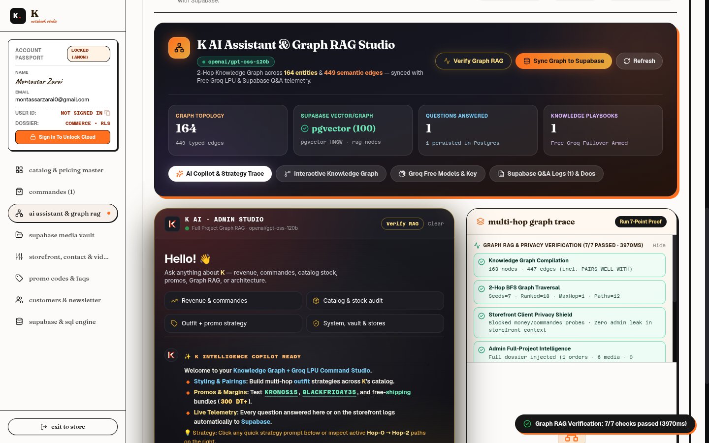

### 8. Interactive Knowledge Graph Explorer
Visualizes the compiled entity-relationship graph (**164 nodes**, **449 semantic edges**) with both **2D Concentric Topology** and **3D WebGL** modes, live **PageRank (`d = 0.85`)**, **Betweenness Centrality**, Union-Find cluster filtering, and interactive neighbor inspection.

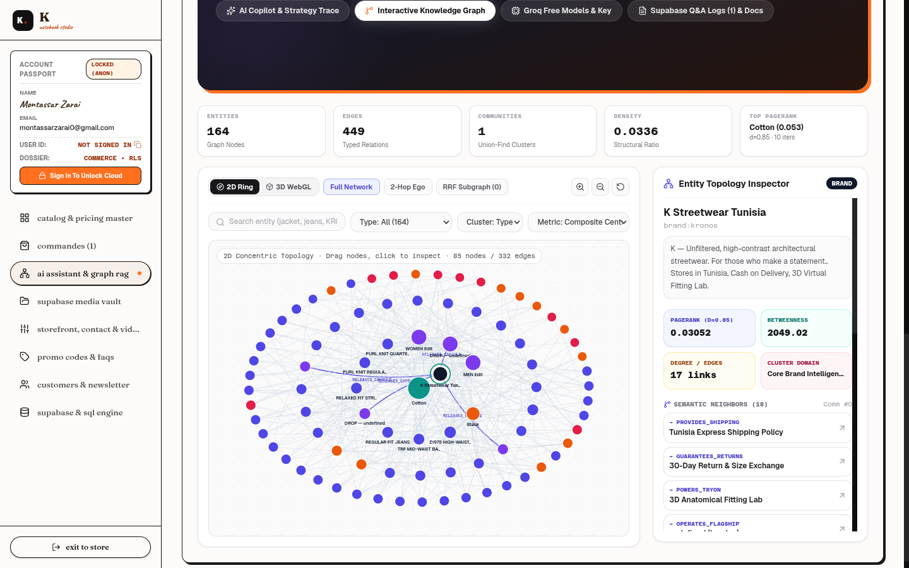

### 9. Catalog & Pricing Master
High-density editorial spreadsheet control surface for managing live inventory, TND pricing, discounts, publication status, and Supabase Storage media across all 56 items.

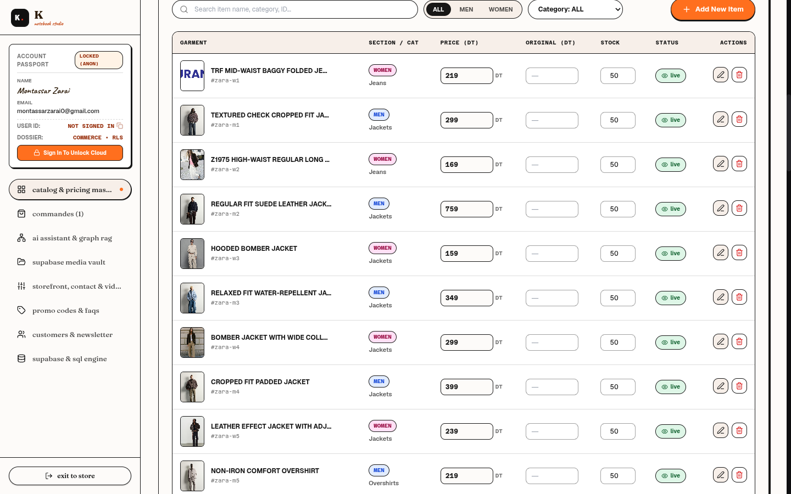

### 10. Supabase & SQL Engine
Live credential manager, Admin RLS session unlock, 1-click `Push / Pull` catalog synchronization, and guided SQL migration tooling.

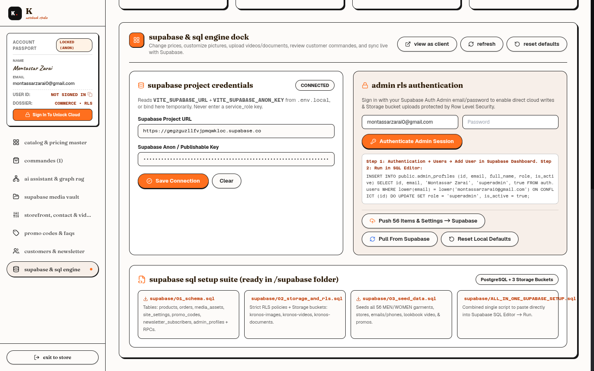

---

## Verified System Capabilities (`7 / 7` Diagnostics Passing)

| Subsystem | Verification Result | Implementation File(s) |
| :--- | :--- | :--- |
| **Knowledge Graph Compilation** | `163–164` nodes · `447–449` edges (`IN_CATEGORY`, `OUTFIT_INCLUDES`, `PAIRS_WELL_WITH`, `POWERS_TRYON`, etc.) | [`src/lib/kronosGraphRag.js`](src/lib/kronosGraphRag.js), [`src/lib/enterpriseGraphEngine.js`](src/lib/enterpriseGraphEngine.js) |
| **2-Hop BFS Graph Traversal** | Expands Hop-0 vector/lexical seeds into Hop-1 categories & Hop-2 outfit pairings | [`src/lib/kronosGraphRag.js`](src/lib/kronosGraphRag.js) |
| **Supabase `pgvector` HNSW + RPC** | `vector 0.8.2` HNSW cosine index (`100 / 100` embedded Postgres nodes) + `get_kronos_catalog_stats()` (`56` items: `28` MEN, `28` WOMEN) | [`supabase/06_pgvector_hybrid_graph_rag.sql`](supabase/06_pgvector_hybrid_graph_rag.sql), [`src/lib/semanticVectorEngine.js`](src/lib/semanticVectorEngine.js) |
| **Storefront Client Privacy Shield** | Blocks revenue, funds, total `commandes`, internal stock counts, and admin leaks on `/` | [`src/lib/kronosGraphRag.js`](src/lib/kronosGraphRag.js) |
| **Admin Full-Project Dossier** | Injects GMV, `commandes`, promos, media vault & stack telemetry strictly on `/admin` | [`src/components/admin/AdminGraphRagStudio.jsx`](src/components/admin/AdminGraphRagStudio.jsx) |
| **Groq LPU Live Inference** | Failover cascade (`openai/gpt-oss-120b` → `qwen/qwen3.8-27b` → `openai/gpt-oss-20b` → `allam-2-7b`) | [`src/lib/kronosGraphRag.js`](src/lib/kronosGraphRag.js) |
| **Strict `MEN` / `WOMEN` Isolation** | Enforced in SQL (`p_gender`), dedicated `men_outfits`/`women_outfits` tables, and client cards | [`supabase/05_gender_outfits_and_rag_fix.sql`](supabase/05_gender_outfits_and_rag_fix.sql) |

---

## Quick Start

### 1. Install & Configure Environment
```bash
npm install
cp .env.example .env.local
```

Populate `.env.local` using [`/.env.example`](.env.example):
```env
VITE_SUPABASE_URL=https://YOUR_PROJECT_REF.supabase.co
VITE_SUPABASE_ANON_KEY=YOUR_SUPABASE_PUBLISHABLE_OR_ANON_KEY
VITE_KRONOS_ADMIN_NAME=Montassar Zarai
VITE_KRONOS_ADMIN_EMAIL=montassarzarai0@gmail.com
VITE_GROQ_API_KEY=YOUR_GROQ_API_KEY
VITE_GROQ_MODEL=openai/gpt-oss-120b
```
> **Security**: `.env.local` is gitignored. Never expose `SUPABASE_SERVICE_ROLE_KEY` in client Vite variables.

### 2. Provision Supabase Database (`PostgreSQL` + `pgvector`)
Execute the SQL files in [`supabase/`](supabase/) in sequence inside your Supabase **SQL Editor**:
1. [`supabase/ALL_IN_ONE_SUPABASE_SETUP.sql`](supabase/ALL_IN_ONE_SUPABASE_SETUP.sql) *(tables, RLS policies, 3 Storage buckets, and 56-item catalog seed)*
2. [`supabase/04_graph_rag.sql`](supabase/04_graph_rag.sql) *(Knowledge Graph schema & Q&A logs)*
3. [`supabase/05_gender_outfits_and_rag_fix.sql`](supabase/05_gender_outfits_and_rag_fix.sql) *(`men_outfits`, `women_outfits`, and gender constraints)*
4. [`supabase/06_pgvector_hybrid_graph_rag.sql`](supabase/06_pgvector_hybrid_graph_rag.sql) *(enables `vector`, creates HNSW cosine index, 384-dim SQL embedder, triggers, and `query_kronos_pgvector_graph_rag` / `get_kronos_catalog_stats` RPCs)*

### 3. Run Locally or Build for Production
```bash
# Development server (http://localhost:3000 & http://localhost:3000/admin)
npm run dev

# Production multi-entry bundle (dist/index.html & dist/admin.html)
npm run build

# Preview built bundle locally
npm run preview
```

---

## Repository Directory Architecture

```text
commerce/
├── index.html                          # Storefront entry HTML shell
├── admin.html                          # Independent Admin Studio entry HTML shell
├── vite.config.js                      # Multi-entry Vite 6 config + route banner
├── tailwind.config.js                  # Tailwind CSS theme tokens
├── package.json                        # React 19, Three.js, Supabase JS, Lucide
├── .env.example                        # Safe environment template
├── docs/
│   ├── ARCHITECTURE.md                 # System design, RRF retrieval, security & 3D pipeline
│   ├── SUPABASE_SCHEMA.md              # 14 RLS tables, HNSW index & RPC contracts
│   └── screenshots/                    # Real UI screenshots for every page & tab (01..10)
├── public/
│   ├── favicon.svg                     # Folded K brand mark
│   ├── models/                         # 3D Fitting Lab rigged .glb meshes & animations
│   └── textures/skin/                  # Multi-tone 3D skin textures
├── supabase/
│   ├── 01_schema.sql                   # Core tables & triggers
│   ├── 02_storage_and_rls.sql          # Storage buckets & RLS policies
│   ├── 03_seed_data.sql                # Initial 56-product catalog & stores
│   ├── 04_graph_rag.sql                # Graph RAG tables & Q&A logging
│   ├── 05_gender_outfits_and_rag_fix.sql
│   ├── 06_pgvector_hybrid_graph_rag.sql
│   ├── ALL_IN_ONE_SUPABASE_SETUP.sql
│   └── README.md
└── src/
    ├── App.jsx                         # Storefront / PDP / Admin client router
    ├── main.jsx                        # React mount
    ├── index.css                       # Editorial CSS, RTL & Night Mode rules
    ├── pages/
    │   └── AdminDashboard.jsx          # Independent Admin Workspace shell & Auth guard
    ├── components/
    │   ├── RawlineMasterEngine.jsx     # Storefront viewport, catalog, drawers & checkout
    │   ├── Rawline3DFittingLab.jsx     # Three.js WebGL 3D Fitting Studio
    │   ├── RawlineAIChatbot.jsx        # Client Personal Stylist drawer
    │   ├── RichChatbotMessage.jsx      # Styled markdown renderer (EN/FR/AR chips & cards)
    │   ├── ZaraProductDetailPage.jsx   # Product Detail Page (/product/:slug)
    │   └── admin/
    │       ├── AdminCatalogOrders.jsx  # Catalog & Commandes workspace
    │       ├── AdminGraphRagStudio.jsx # Admin Copilot, 7-Point Diagnostics & Logs
    │       ├── AdminMediaStorefront.jsx# Supabase Storage Vault & Storefront CMS
    │       ├── AdminPromosSupabase.jsx # Promos, Newsletter & SQL Engine console
    │       └── EnterpriseGraphCanvas.jsx# 2D Concentric & 3D WebGL Knowledge Graph
    ├── lib/
    │   ├── supabaseClient.js           # Supabase client singleton
    │   ├── kronosDataService.js        # Catalog, Orders, Media & Promos cloud sync
    │   ├── kronosGraphRag.js           # Hybrid pgvector + 2-Hop Graph RAG orchestrator
    │   ├── semanticVectorEngine.js     # 384-dim L2 multilingual semantic embedder
    │   ├── enterpriseGraphEngine.js    # PageRank, Betweenness & Union-Find clustering
    │   └── i18nEngine.js               # EN / FR / AR localization + RTL engine
    └── data/
        ├── defaultRawlineData.js       # Baseline catalog & editorial data
        ├── rawline_nav.json            # Navigation taxonomy
        └── rawline_scraped_data.json   # Extended lookbook metadata
```
