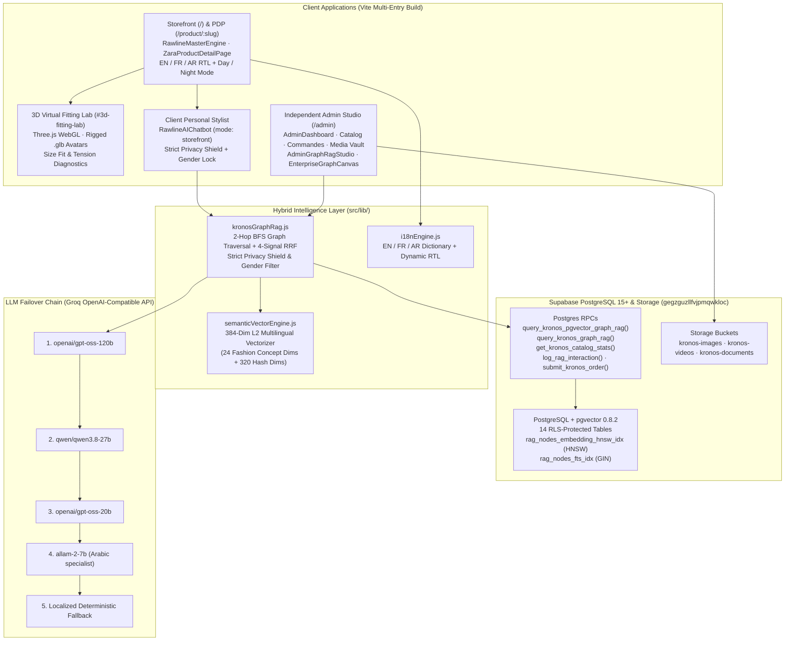
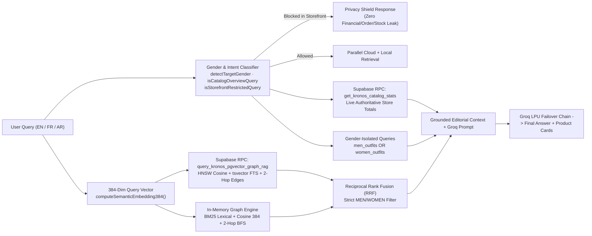

# K — System Architecture & AI Retrieval Blueprint

This document describes the production architecture of **K** (KRONOS Tunisia): a multi-entry React 19 + Vite 6 storefront, Three.js 3D Virtual Fitting Lab, Supabase (`pgvector` HNSW + RLS) persistence engine, and dual-channel Hybrid Graph RAG intelligence stack.

---

## 1. High-Level System Architecture

---

## 2. Multi-Entry Application Routing

Configured in [`vite.config.js`](../vite.config.js) and [`src/App.jsx`](../src/App.jsx):

| Route / Entry | HTML Shell | Primary Component | Access Control |
| :--- | :--- | :--- | :--- |
| `/` | `index.html` | [`RawlineMasterEngine.jsx`](../src/components/RawlineMasterEngine.jsx) | Public read (`anon` + `authenticated`) |
| `/product/:slug` | `index.html` | [`ZaraProductDetailPage.jsx`](../src/components/ZaraProductDetailPage.jsx) | Public read |
| `/#3d-fitting-lab` | `index.html` | [`Rawline3DFittingLab.jsx`](../src/components/Rawline3DFittingLab.jsx) | Public read (client-side Three.js WebGL) |
| `/admin`, `/admin-kronos-2026` | `admin.html` | [`AdminDashboard.jsx`](../src/pages/AdminDashboard.jsx) | Public preview read; cloud writes & PII gated by Supabase Auth + `admin_profiles` RLS |

---

## 3. Hybrid `pgvector` HNSW + 2-Hop Graph RAG Pipeline

Unlike standard vector-only RAG pipelines that miss multi-item outfit pairings or hallucinate inventory counts, `askKronosGraphRag()` in [`src/lib/kronosGraphRag.js`](../src/lib/kronosGraphRag.js) fuses four independent retrieval signals:

### Aligned Client–Server Embedding Math (`semanticVectorEngine.js` ↔ `kronos_semantic_embed`)
- Both TypeScript/JS ([`src/lib/semanticVectorEngine.js`](../src/lib/semanticVectorEngine.js)) and PostgreSQL PL/pgSQL ([`supabase/06_pgvector_hybrid_graph_rag.sql`](../supabase/06_pgvector_hybrid_graph_rag.sql)) compute bit-aligned **384-dimensional L2-normalized vectors**:
  - **Concept Dimensions**: 24 curated multilingual fashion & commerce synonym buckets bridging English, French, and Arabic (`leather`/`cuir`/`جلد`, `jacket`/`blouson`/`جاكيت`, `trousers`/`pantalon`/`بنطلون`, `shipping`/`livraison`/`توصيل`, etc.).
  - **Subword/Token Hash Dimensions**: Deterministic trigram + token feature hashing across the remaining dimensions.
- Benefit: Queries embed locally in **&lt;1 ms** with **zero external embedding API latency or cost**, while `rag_nodes.embedding` supports native Postgres HNSW cosine search (`rag_nodes_embedding_hnsw_idx`).

---

## 4. Security & Channel Isolation Model

1. **Storefront Client Privacy Shield (`channel: 'storefront'`)**:
   - `isStorefrontRestrictedQuery()` intercepts storefront probes asking for revenue, funds, total customer orders (`commandes`), subscriber counts, internal stock units, or admin credentials.
   - `buildKronosKnowledgeGraph(..., { includeInternalStock: false })` strips internal stock quantities and admin KPIs from every storefront node before prompt assembly.
   - `sanitizeStorefrontAnswer()` removes technical framework terms (`Groq`, `Supabase`, `Graph RAG`, `Strategy:`, `Knowledge Graph`, `nodes`) from client replies so shoppers experience a clean boutique advisor.
2. **Strict `MEN` / `WOMEN` Gender Isolation**:
   - `detectTargetGender()` detects EN, FR, and AR gender intent and enforces `p_gender` inside `query_kronos_pgvector_graph_rag`, selects exclusively from `men_outfits` or `women_outfits`, and filters ranked recommendation cards.
3. **Admin Studio Full-Project Dossier (`channel: 'admin_studio'`)**:
   - Injects `ADMIN FULL PROJECT DOSSIER` (GMV in DT, status & city breakdown, low-stock items, promos, media buckets, subscriber count, Graph topology telemetry, and platform stack) exclusively inside `/admin`.
   - Write operations against `products`, `promo_codes`, `site_settings`, `orders`, `rag_nodes`, `rag_edges`, and Storage buckets are enforced at the database layer via Supabase Row-Level Security (`RLS`).

---

## 5. Multilingual (`EN` / `FR` / `AR`) & Day/Night UI

- **Localization ([`src/lib/i18nEngine.js`](../src/lib/i18nEngine.js))**: Reactive `EN` / `FR` / `AR` translation engine covering navigation, catalog badges, checkout, drawers, and Chatbot quick actions, automatically toggling `dir="rtl"` for Arabic.
- **3D Fitting Lab ([`src/components/Rawline3DFittingLab.jsx`](../src/components/Rawline3DFittingLab.jsx))**: Real-time Three.js WebGL renderer loading rigged `man.glb` (184 cm), `woman.glb` (175 cm), and `animations.glb`, supporting multi-angle presets (`FRONT`, `3/4`, `SIDE`, `BACK`), skin tone shaders, studio lighting presets, and live garment fitting swaps.
- **Interactive Knowledge Graph ([`src/components/admin/EnterpriseGraphCanvas.jsx`](../src/components/admin/EnterpriseGraphCanvas.jsx))**: Computes PageRank (`d = 0.85`), Betweenness Centrality, Union-Find clusters, and renders both **2D Concentric Ring** and **3D WebGL** interactive inspection views inside `/admin`.
